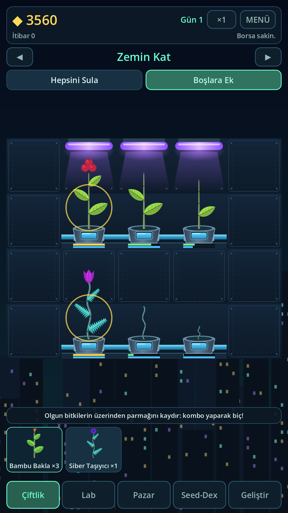
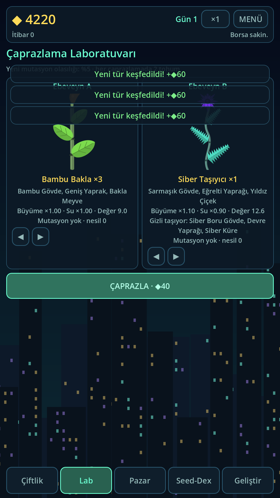
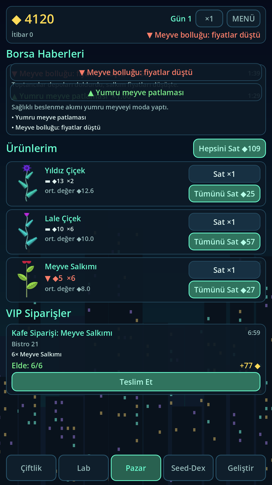
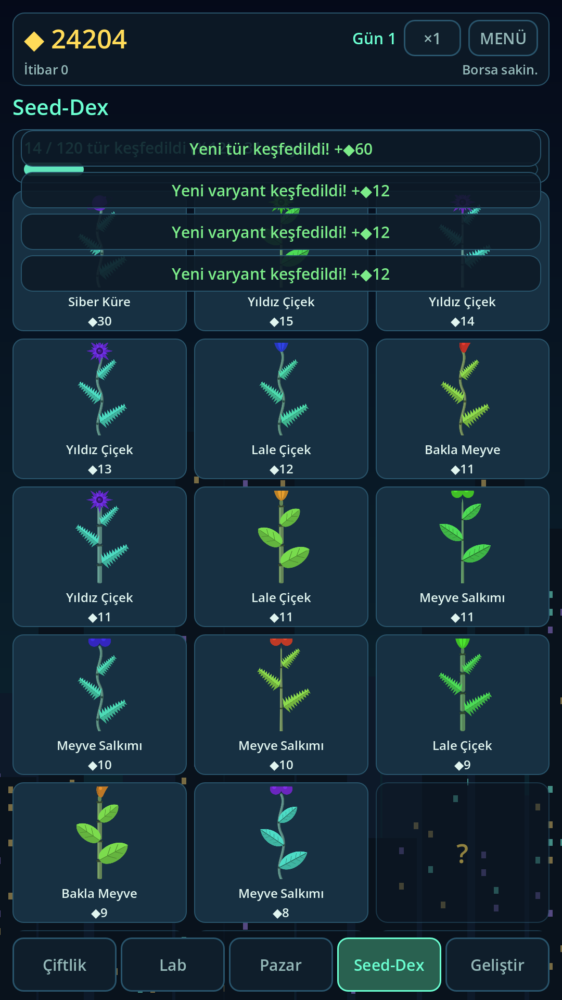
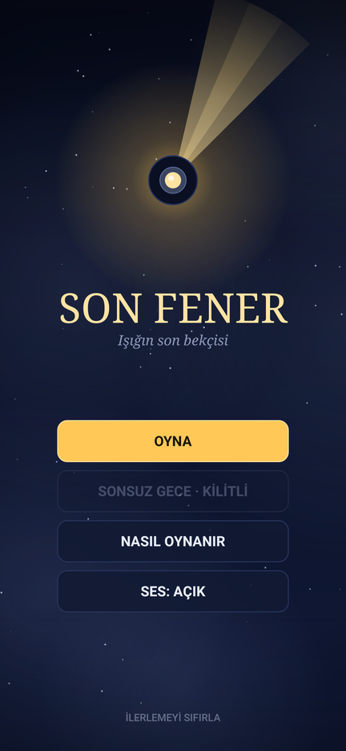
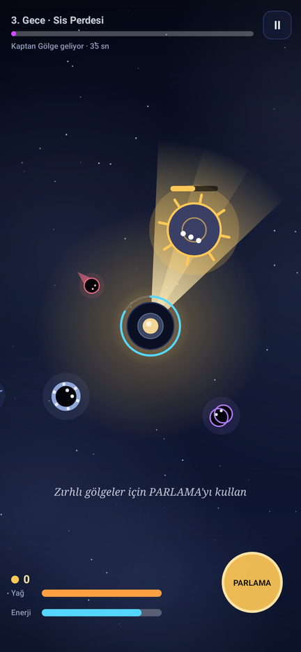
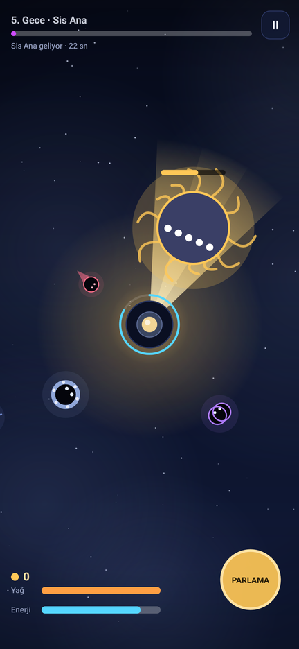
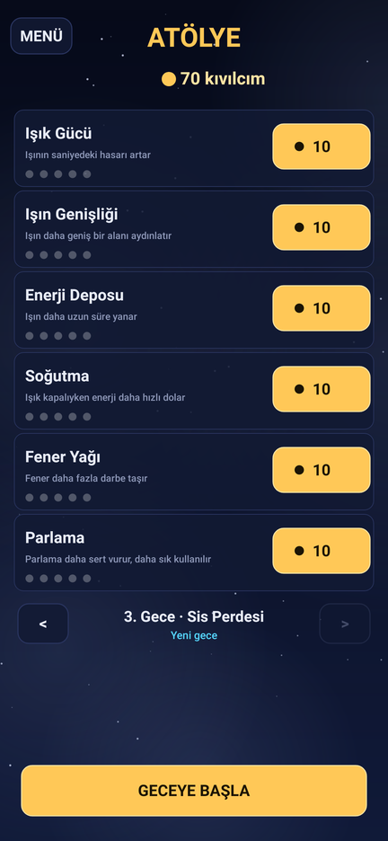
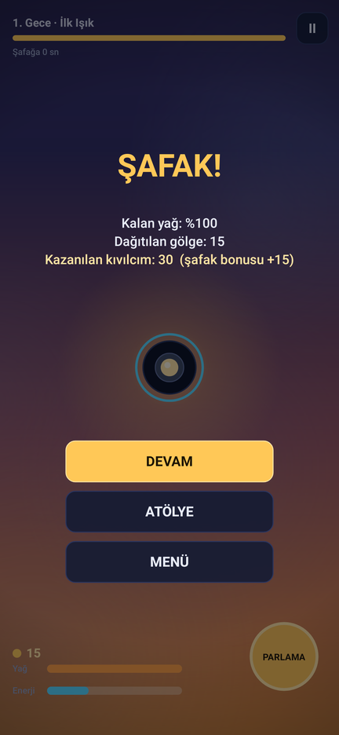

# tigirer: oyun deposu

Bu depoda iki oyun ve onları geliştirmek için kurulu bir çerçeve var.

| Oyun | Motor | Klasörler | Durum |
|---|---|---|---|
| **FloraLab: Cyber Harvest**: dikey çiftlik, bitki genetiği, otomasyon | Godot 4.7.2 (GDScript) | `src/`, `assets/`, `tests/`, `project.godot` | FAZ 1–5 hazır, release APK 1.0.0 dışa aktarıldı |
| **Son Fener**: tek parmakla savunma | Java, yerel Android | `app/`, `releases/` | Tamam (1.0), aşağıda |

Çerçeve: [Claude Code Game Studios](https://github.com/Donchitos/Claude-Code-Game-Studios) 1.2.0, Godot için yapılandırıldı (`.claude/`, `CLAUDE.md`, `project.yaml`).

## FloraLab: Cyber Harvest

Terk edilmiş bir gökdelenin katlarında hidroponik bir çiftlik kur; iki tohumu çaprazla, ebeveyn genlerini (büyüme hızı, su tüketimi, pazar değeri, renk) aktar, **%5 ihtimalle** nadir bir mutasyon yakala; bitkileri kaydırarak hasat et, dronlara devret, dinamik borsada sat, Seed-Dex'i doldur. Dikey (1080×1920) Android oyunu.

<p>
  
  
  
  
</p>

| Faz | Kapsam | Durum |
|---|---|---|
| 1 | `PlantGene` kaynağı, Mendel çaprazlama, %5 mutasyon, katmanlı `PlantInstance`, `SignalBus` | **Hazır, testli** |
| 2 | Hidroponik ızgara (`TileMapLayer`), büyüme evreleri, su/UV, kaydırarak hasat + kombo, ses/parçacık | **Hazır, testli** |
| 3 | Dinamik borsa (arz-talep + haber olayları), envanter, VIP siparişler | **Hazır, testli** |
| 4 | Sulama/UV matrisi, hasat dronu durum makinesi, yeni katlar | **Hazır, testli** |
| 5 | Dikey mobil arayüz, Seed-Dex, şifreli kayıt, çevrimdışı kazanç, ayarlar (yazı boyutu, renk körlüğü, hareketi azalt) | **Hazır, testli** |

```bash
# Oyunu aç (ana sahne src/ui/main.tscn). Temiz klonda önce: godot --headless --path . --import  (çeviri dosyasını üretir)
godot --path . --windowed

bash tools/run_tests.sh                                   # tüm testler (350)
bash tools/capture_faz5_evidence.sh                       # arayüz ekran görüntülerini yeniden üret (gerçek çizim, 1080x1920 ve 1080x2400)
bash tools/setup-godot-android.sh                         # bir kez: Android dışa aktarma araçları
godot --headless --export-debug "Android" build/floralab-debug.apk
# Release (imza bilgisi ortam değişkeninden; anahtar deposu depoda YOK):
GODOT_ANDROID_KEYSTORE_RELEASE_PATH=... GODOT_ANDROID_KEYSTORE_RELEASE_USER=... GODOT_ANDROID_KEYSTORE_RELEASE_PASSWORD=... \
  godot --headless --export-release "Android Release" build/floralab-1.0.0.apk
```

**Bilinen sınırlar (dürüst liste):** gerçek bir Android cihazda/emülatörde çalıştırılmadı (APK paket, imza ve başsız açılış olarak doğrulandı);
ekonomi insan oynatılarak değil benzetimle dengelendi; kayıt şifrelemesi caydırıcıdır, güvenlik değildir; gdUnit4 yerine kendi test koşucusu
kullanılıyor (üçüncü taraf kod çalıştırma izni verilmedi); ses yer tutucudur; yalnızca Türkçe.

- Mimari, klasör şeması, Autoload listesi, genetik kuralları ve formüller: **[docs/architecture/floralab-architecture.md](docs/architecture/floralab-architecture.md)**
- Tasarım kaydı: [design/game-brief.md](design/game-brief.md) · Kanıt ekran görüntüleri: [faz1](production/qa/evidence/faz1-plant-instance/README.md), [faz2](production/qa/evidence/faz2-farm/README.md), [faz5](production/qa/evidence/faz5-ui/README.md)
- Test altyapısı ve gdUnit4 durumu: [tests/README.md](tests/README.md)

---

# Son Fener

Tek parmakla oynanan, Türkçe, dikey ekranlı bir Android savunma oyunu.

Kandil Burnu'nun fener bekçisisin. Her gece denizden sis yükselir ve gölgeler feneri söndürmek için kıyıya sürünür. Parmağınla ışığı yönlendir, enerjini yönet, şafağa dayan. Gölgeler dağılınca geriye kıvılcımlar, yani unutulmuş anılar kalır; onlarla fenerini güçlendir.

<p>
  
  
  
  
  
</p>

> Ekran görüntüleri, oyunun gerçek çizim koduyla test ortamında üretilmiştir (bkz. [Test](#test)).

## Kurulum

1. [`releases/SonFener-1.0.apk`](releases/SonFener-1.0.apk) dosyasını Android telefonuna indir (Android 7.0 ve üstü).
2. Dosyaya dokun. Android sorarsa o kaynaktan (tarayıcı ya da dosya yöneticisi) **bilinmeyen uygulama yüklemeye izin ver**.
3. Yükle ve **Son Fener**'i aç.

APK, Android'in otomatik test (debug) anahtarıyla imzalıdır; Play Store için değildir. Aynı uygulamanın başka bir makinede derlenmiş sürümünü üstüne yüklemek “imza uyuşmuyor” hatası verebilir. Böyle olursa önce eskisini kaldır.

## Nasıl oynanır

- **Ekrana dokun ve sürükle:** Işın parmağının yönüne döner. Parmağını kaldırırsan söner.
- **Işın enerji harcar.** Enerji bitince ışık ısınır, soğuyana kadar yanmaz.
- **Işıktaki gölgeler yavaşlar ve erir.** Fenere ulaşan gölge yağı azaltır; yağ biterse fener söner.
- **PARLAMA** (sağ alt): çevredeki bütün gölgelere vurur, geri iter ve zırhı deler.
- Şafağa dayan. 3. ve 5. gecede boss'u yen. Kıvılcımları atölyede harca.

Bütün kurallar, gölge/gece/geliştirme tabloları ve hikâyenin tamamı: **[docs/GAME_DESIGN.md](docs/GAME_DESIGN.md)**

## Derleme

Gereksinimler: JDK 17 veya üstü, Android SDK (platform `android-34`, build-tools `34.0.0`).

```bash
echo "sdk.dir=/Android/SDK/yolu" > local.properties   # ya da ANDROID_HOME ayarla
./gradlew assembleRelease
# çıktı: app/build/outputs/apk/release/app-release.apk
```

## Test

```bash
./gradlew testDebugUnitTest
```

- **Oyun mantığı** (`World`, kayıt, geliştirmeler) JVM'de test edilir.
- **Denge testleri**, bilgisayarın oynadığı bir bot'la geceleri yüzlerce kez oynar ve zorluk eğrisinin bozulmadığını doğrular.
- **Ekran testleri** (Robolectric, gerçek `Canvas`): her ekranı çizer, menüden ilk geceye uzanan akışı ve kazanma/kaybetme sonuçlarını dener; ekran görüntülerini `app/build/shots/` altına yazar. İlk çalıştırmada Robolectric, Android 14 paketini Maven'dan indirir.

## Sonraki oyunlar: Godot ortamı

Bulut oturumlarında Godot 4.7.2 + Android araç zinciri tek komutla kurulur: `bash tools/setup-godot-android.sh`. Neyin denendiği ve neyin denenmediği, APK/ekran görüntüsü/dokunma testi tarifleriyle birlikte: **[docs/GODOT_ORTAMI.md](docs/GODOT_ORTAMI.md)**

## Proje yapısı

```
app/src/main/java/com/tigirer/sonfener/
  core/        Android'den bağımsız oyun mantığı (World, ShadowType, Upgrades, Levels, SaveData, Story)
  *Screen.java Menü, hikâye, atölye, oyun ve nasıl oynanır ekranları
  Gfx.java     Çizim yardımcıları (arka plan, fener, ışın, gölgeler)
  Sfx.java     Çalışma anında üretilen ses efektleri
app/src/test/  Birim, denge ve ekran testleri
docs/          Tasarım belgesi, Godot ortamı ve ekran görüntüleri
tools/         Geliştirme ortamı kurulumu (Godot + Android), test koşucusu, ekran görüntüsü aracı
releases/      Derlenmiş APK
```

## Durum ve bilinen sınırlar

- Oyun **gerçek bir Android cihazda veya emülatörde çalıştırılmadı.** Doğrulama: birim testleri, bot simülasyonları, gerçek `Canvas` ile ekran çizimi ve APK'nın paket/imza kontrolü. **Ses ve titreşim gerçek donanımda denenmedi**; hata olursa sessizce devre dışı kalacak şekilde yazıldı.
- Denge bot'la ayarlandı; bir insanla test edilmedi. Sayılar yol göstericidir.
- Yalnızca dikey ekranı destekler.
